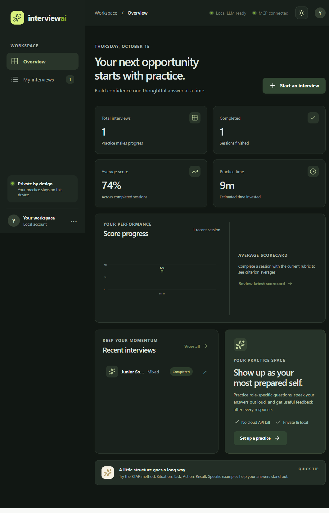
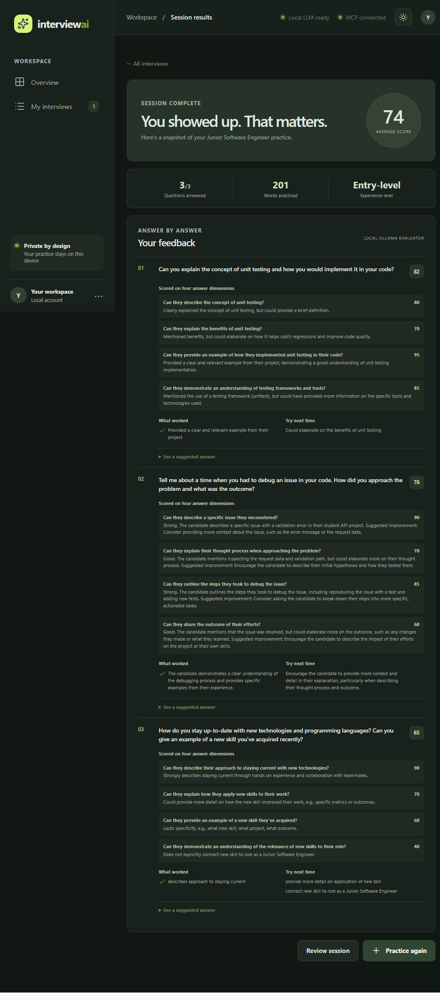

# InterviewAI

A local-first AI mock interview coach for role-specific practice, voice answers, and actionable feedback.

## Portfolio preview

The [static portfolio site](https://YashChauhan178.github.io/InterviewAI/) showcases the project. This public repository intentionally contains only the portfolio assets; the interactive application, local AI services, and interview data remain on the developer's machine.

## Highlights

- Tailored interview sessions based on role, experience level, interview type, resume, and job description.
- Typed or spoken responses, browser speech playback, and local transcription support.
- Rubric-based feedback, suggested answers, saved session history, scorecards, and progress tracking.
- React/Vite frontend, FastAPI backend, SQLite persistence, local Ollama integration, and project MCP tools.

## Screenshots

### Dashboard

### Interview results

## Privacy and deployment

Interview content and local model requests are intended to stay on the user's computer. The public GitHub Pages site is a static showcase only; it does not expose the interactive backend or personal interview data.
