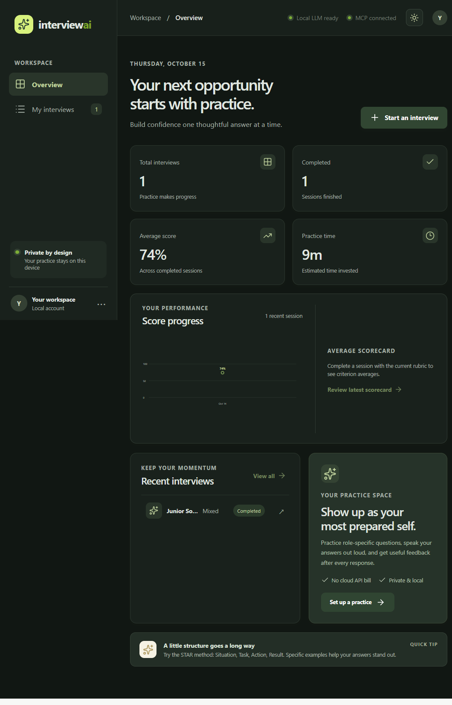
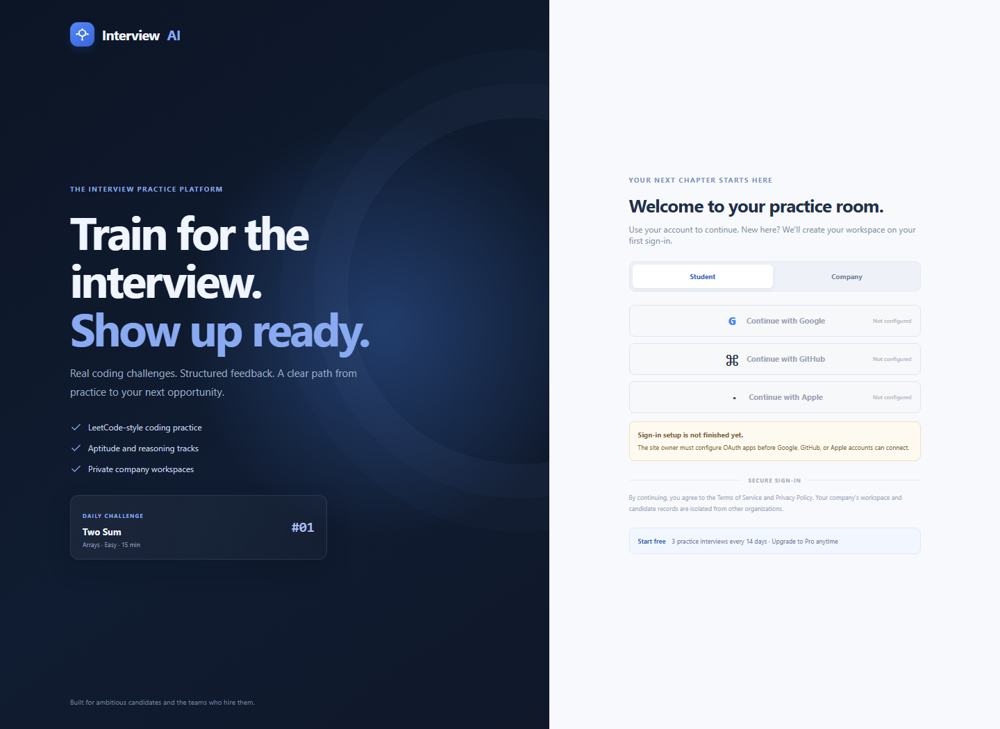
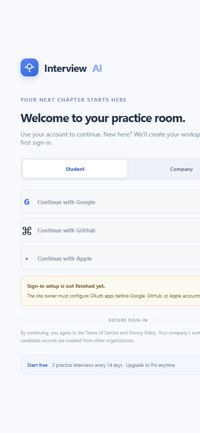
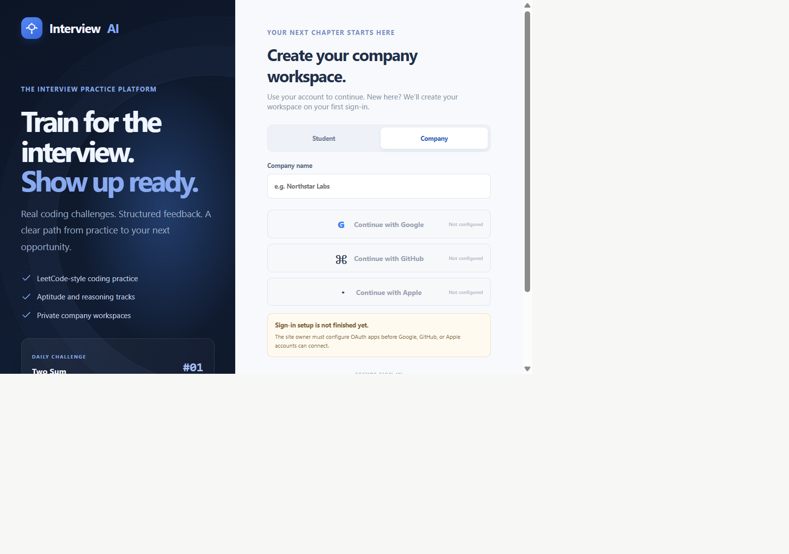
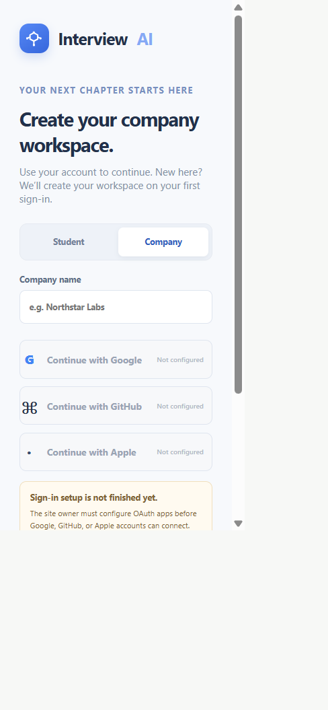

# InterviewAI

**An AI-powered interview-practice platform for students and hiring teams.**

InterviewAI creates role-specific practice sessions from a student's target role, difficulty, resume, and job description. Choose an aptitude, reasoning, or coding/interview track; then review structured feedback and track progress in a competitive coding workspace. The app includes OAuth sign-in, student subscriptions, and isolated company workspaces; provider and billing credentials must be configured by the operator.

The development setup is designed for Windows and uses a local [Ollama](https://ollama.com/) model; no paid AI API key is required for local model use.



## Contents

- [Features](#features)
- [How it works](#how-it-works)
- [Requirements](#requirements)
- [Installation and startup on Windows](#installation-and-startup-on-windows)
- [First-run verification](#first-run-verification)
- [Using the application](#using-the-application)
- [Configuration](#configuration)
- [SaaS configuration (OAuth, billing, and workspaces)](#saas-configuration-oauth-billing-and-workspaces)
- [API overview](#api-overview)
- [Privacy and local data](#privacy-and-local-data)
- [Troubleshooting](#troubleshooting)
- [Development and tests](#development-and-tests)
- [Deployment notes](#deployment-notes)
- [Project structure](#project-structure)

## Features

- **AI-generated questions tailored to your role:** Select an experience level, interview type, and 3–10 questions. Ollama receives the role and relevant resume/job-description context to generate questions, competencies, evaluation criteria, and suggested answers. The API records whether the questions came from Ollama or a validated fallback.
- **Three focused practice tracks:** Basic Aptitude, Logical Reasoning, and Coding Rounds & Interview. Choose Easy, Medium, or Hard; coding prompts include examples and are answered in a dedicated language-aware editor.
- **Student records:** Save each attempt with a student name and optional student ID, alongside its questions, answers, scores, and feedback.
- **Student accounts and Pro billing:** Sign in with configured Google, GitHub, or Apple OAuth; upgrade to Pro through a configured Razorpay monthly subscription.
- **Free practice allowance:** Get 3 free interviews in each rolling 14-day window. Your account shows remaining sessions and blocks new sessions until an interview ages out.
- **Company workspaces:** Create isolated organization workspaces, invite students using one-time links, and review workspace candidate progress.
- **Resume and job-description parsing:** Upload PDF, TXT, or Markdown files for local text extraction. Analyze job requirements and compare them with resume skills.
- **Structured answer feedback:** Evaluate answers for relevance, completeness, clarity, and technical accuracy. Review the score, strengths, improvement suggestions, and a suggested answer.
- **Voice practice:** Record answers in the browser and transcribe them locally using Faster-Whisper. Browser speech synthesis can read questions aloud. Typed answers are always available.
- **Interview history:** Save student attempts and answers in Microsoft SQL Server, see recent sessions and score trends, reopen previous sessions, and delete interviews from the history view.
- **Local AI help chat:** Ask the configured Ollama model for help with interview preparation or the application. Recent chat context is limited and is not saved to the interview database.
- **Document analysis through MCP:** The local InterviewAI MCP server exposes tools for extracting job requirements and comparing a candidate resume with a job description.
- **Responsive interface:** Includes dashboard metrics, light/dark themes, progress tracking, accessible focus states, and clear loading and error messages.

### Current sign-in experience









## How it works

```text
React + Vite in your browser
          │ /api requests (Vite proxy)
          ▼
FastAPI backend ─────── Microsoft SQL Server student/interview records
     │
     ├── Ollama on localhost ── question generation, evaluation, help chat
     ├── Local MCP subprocess ── job/resume analysis tools
     ├── PyMuPDF ── PDF text extraction
     └── Faster-Whisper ── local audio transcription
```

The frontend development server proxies `/api` requests to `http://127.0.0.1:8000`. The backend starts the local MCP server as a subprocess when needed. Ollama and Faster-Whisper models run on the same computer.

## Requirements

- Windows 10 or 11
- Python 3.10 or 3.12 (these versions are exercised by CI)
- Node.js 22.12 or newer (or Node.js 20.19 or newer)
- [Ollama for Windows](https://ollama.com/download)
- Microsoft SQL Server Database Engine, [SQL Server Management Studio](https://learn.microsoft.com/sql/ssms/download-sql-server-management-studio-ssms), and the Microsoft ODBC Driver 18 for SQL Server. SSMS is a client; it does not install or run the database engine.
- Enough disk space for the Ollama model (approximately 2–3 GB for `llama3.2:3b`) and the optional Faster-Whisper model
- A microphone for voice recording; typed answers do not require one

The first Faster-Whisper transcription may download its model and can take longer than later recordings. Browser microphone access is available on `localhost` in supported browsers; allow microphone permission when prompted.

## Installation and startup on Windows

### 1. Clone or download the repository

If you have Git installed:

```powershell
git clone https://github.com/YashChauhan178/InterviewAI.git
cd InterviewAI
```

If you already have the project, open PowerShell in its repository folder. The commands below assume the repository root contains `backend`, `frontend`, and `README.md`.

### 2. Install and start Ollama

Install Ollama, then pull the default model in PowerShell:

```powershell
ollama pull llama3.2:3b
ollama list
```

Ollama normally runs in the background and serves its local API at `http://127.0.0.1:11434`. If `ollama` is not recognized, finish installing Ollama and open a new PowerShell window. Keep Ollama running while using AI features.

### 3. Create and configure the SQL Server database

In SSMS, connect to your local SQL Server instance using Windows authentication and create a database named `InterviewAI` if it does not already exist. Note the server/instance name shown in SSMS (for example, `localhost` or `localhost\SQLEXPRESS`).

Before starting the backend, set these variables in the same PowerShell window. Replace the server value with the one from SSMS:

```powershell
$env:INTERVIEWAI_DB_BACKEND = "sqlserver"
$env:INTERVIEWAI_SQLSERVER_SERVER = "localhost\SQLEXPRESS"
$env:INTERVIEWAI_SQLSERVER_DATABASE = "InterviewAI"
```

The backend uses Windows integrated authentication. It creates the interview and answer tables and applies schema updates automatically. It will report an explicit connection error if the SQL Server service, database, or ODBC driver is unavailable; it does not silently switch to SQLite.

### 4. Set up and start the backend

From the **repository root**, run:

```powershell
py -m venv backend\.venv
backend\.venv\Scripts\python.exe -m pip install --upgrade pip
backend\.venv\Scripts\python.exe -m pip install -r backend\requirements.txt
backend\.venv\Scripts\python.exe -m uvicorn --app-dir backend main:app --reload
```

Keep this PowerShell window open. The `--app-dir backend` option is important: it adds the backend directory to Python's import path, so Uvicorn can import `main:app` when the command is run from the repository root. The configured SQL Server database is initialized automatically.

Check the backend in a browser:

- API health: <http://127.0.0.1:8000/health>
- Interactive API documentation: <http://127.0.0.1:8000/docs>
- Ollama status: <http://127.0.0.1:8000/api/llm/status>
- MCP status: <http://127.0.0.1:8000/api/mcp/status>
- Storage status: <http://127.0.0.1:8000/api/storage/status>

### 5. Set up and start the frontend

Open a **second PowerShell window** in the repository root and run:

```powershell
cd frontend
npm ci
npm run dev
```

Open the URL Vite prints in the terminal, usually <http://localhost:5173>. Keep both the backend and frontend terminal windows running while using the application.

On later runs, dependency installation is not needed. Start the backend from the repository root:

```powershell
$env:INTERVIEWAI_DB_BACKEND = "sqlserver"
$env:INTERVIEWAI_SQLSERVER_SERVER = "localhost\SQLEXPRESS"
$env:INTERVIEWAI_SQLSERVER_DATABASE = "InterviewAI"
backend\.venv\Scripts\python.exe -m uvicorn --app-dir backend main:app --reload
```

Then start the frontend in a second window:

```powershell
cd frontend
npm run dev
```

To stop either development server, focus its terminal and press **Ctrl+C**.

## First-run verification

1. Confirm `http://127.0.0.1:8000/health` returns `{"status":"healthy"}`.
2. Open the app at `http://localhost:5173`.
3. Check the app's Ollama status. If the configured model is missing, run `ollama pull llama3.2:3b`.
4. Create a short practice interview for a role such as “Software Engineer” or “Financial Analyst.”
5. Confirm the interview shows role-relevant questions and can be opened from interview history.
6. Submit an answer to see the evaluation and scorecard.
7. Optionally try a PDF/TXT/MD upload, voice recording, question read-aloud, and AI help chat.

The interview response includes `generation_source` (`ollama` or `fallback`). Ollama-generated questions are role- and context-driven. A validated fallback question set is only used if model output cannot be validated; if Ollama itself is unavailable, the app reports an error rather than claiming fallback output was AI-generated.

## Using the application

### Create and complete an interview

1. Choose a target role and experience level.
2. Enter the student name and optional student ID. Choose one of **Basic Aptitude**, **Logical Reasoning**, or **Coding Rounds & Interview**, set difficulty, then choose 3–10 questions.
3. Optionally upload a resume and job description. The application extracts text and can show a comparison of matching and missing skills.
4. Start the interview. Questions are shown one at a time with progress information.
5. Type your response, or record a spoken answer and submit the local transcript. Coding tracks use the language selector and code editor; solutions are AI-reviewed but are not executed.
6. Submit each answer in order. Review its feedback, then continue until the scorecard appears.
7. Find saved sessions in **My interviews**. Use the delete control and confirm to remove a session and its associated answers.

### Documents and audio

- Resume and job-description files: PDF, TXT, or MD; maximum 10 MB per upload.
- Text files must be UTF-8 encoded.
- PDFs must contain extractable text. Scanned/image-only PDFs are not OCR processed.
- Audio uploads: WEBM, WAV, MP3, M4A, MP4, OGG, OPUS, AAC, or FLAC; maximum 25 MB.
- Transcription uses Faster-Whisper on the local machine with the `tiny.en` model by default.

## Configuration

Set optional environment variables in the same PowerShell window before starting the backend:

```powershell
$env:INTERVIEWAI_DB_BACKEND = "sqlserver"
$env:INTERVIEWAI_SQLSERVER_SERVER = "localhost"
$env:INTERVIEWAI_SQLSERVER_DATABASE = "InterviewAI"
$env:OLLAMA_MODEL = "llama3.2:3b"
$env:WHISPER_MODEL = "tiny.en"
backend\.venv\Scripts\python.exe -m uvicorn --app-dir backend main:app --reload
```

| Variable | Default | Description |
| --- | --- | --- |
| `INTERVIEWAI_DB_BACKEND` | `sqlserver` | Select `sqlserver` or `sqlite`. |
| `INTERVIEWAI_SQLSERVER_SERVER` | `localhost\SQLEXPRESS` | SQL Server host or instance name. Uses Windows integrated authentication. |
| `INTERVIEWAI_SQLSERVER_DATABASE` | `InterviewAI` | Existing database to use; create it in SSMS before starting the API. |
| `INTERVIEWAI_SQLSERVER_DRIVER` | `ODBC Driver 18 for SQL Server` | Installed Microsoft ODBC driver name. |
| `INTERVIEWAI_SQLSERVER_CONNECTION_STRING` | unset | Optional full ODBC connection string override. Keep secrets out of source control. |
| `OLLAMA_MODEL` | `llama3.2:3b` | Model tag to use for questions, answer evaluation, and help chat. The model must already be pulled with Ollama. |
| `OLLAMA_BASE_URL` | `http://127.0.0.1:11434` | Ollama API URL. For privacy, the backend only accepts HTTP URLs on localhost or a loopback IP address. |
| `WHISPER_MODEL` | `tiny.en` | Faster-Whisper model used for local transcription. |

## SaaS configuration (OAuth, billing, and workspaces)

Authentication and payment flows remain unavailable until the operator registers OAuth applications and configures Razorpay. Google, GitHub, and Apple sign-in automatically creates an account the first time a verified provider identity is used. InterviewAI does not provide password-based sign-in. For local development, the backend reads OAuth settings from the git-ignored `backend\.env` file; never put secrets in frontend code, source control, screenshots, or chat messages.

| Variable | Purpose |
| --- | --- |
| `INTERVIEWAI_SESSION_SECRET` | Stable, private signing key for browser sessions. Required in deployment; generate a random secret and keep it consistent across backend restarts/instances. |
| `INTERVIEWAI_PUBLIC_URL` | Public frontend origin, such as `https://app.example.com`. |
| `INTERVIEWAI_API_PUBLIC_URL` | Public API origin used to build OAuth callback URLs. If omitted, callbacks use `INTERVIEWAI_PUBLIC_URL`. |
| `INTERVIEWAI_CORS_ORIGINS` | Comma-separated allowed frontend origins. Defaults to the two local Vite origins; set exact HTTPS production origins. |
| `INTERVIEWAI_COOKIE_SECURE` | Set to `true` behind HTTPS so the session cookie is sent only over secure connections. |
| `GOOGLE_CLIENT_ID`, `GOOGLE_CLIENT_SECRET` | Google OAuth application credentials. |
| `GITHUB_CLIENT_ID`, `GITHUB_CLIENT_SECRET` | GitHub OAuth application credentials. |
| `APPLE_CLIENT_ID`, `APPLE_CLIENT_SECRET` | Apple Sign in with Apple service ID and generated client-secret JWT. |
| `RAZORPAY_KEY_ID`, `RAZORPAY_KEY_SECRET` | Razorpay API credentials (use test credentials while validating). |
| `RAZORPAY_PRO_PLAN_ID` | Razorpay recurring plan ID. It must match the configured amount and currency. |
| `RAZORPAY_WEBHOOK_SECRET` | Secret used to verify Razorpay webhook signatures; checkout stays disabled without it. |
| `INTERVIEWAI_PRO_AMOUNT` | Monthly Pro amount in the currency's minor units. Defaults to `900` (USD $9.00). |
| `INTERVIEWAI_PRO_CURRENCY` | Pro plan currency. Defaults to `USD`; the Razorpay plan must use the same currency. |
| `INTERVIEWAI_SALES_EMAIL` | Optional company-plan contact email shown in the pricing page. |

For local development with the Vite proxy, use these callback URLs:

```text
http://localhost:5173/api/auth/google/callback
http://localhost:5173/api/auth/github/callback
```

Configure Google in Google Cloud Console with `http://localhost:5173` as an authorized JavaScript origin and `http://localhost:5173/api/auth/google/callback` as an authorized redirect URI. Add your Google account to the consent screen's test users while the app remains in testing mode. Configure GitHub's OAuth app callback URL as `http://localhost:5173/api/auth/github/callback`.

Open `backend\.env` locally and add the provider client IDs and secrets you received from each provider. For example:

```dotenv
GOOGLE_CLIENT_ID=your-client-id.apps.googleusercontent.com
GOOGLE_CLIENT_SECRET=your-google-client-secret
GITHUB_CLIENT_ID=your-github-client-id
GITHUB_CLIENT_SECRET=your-github-client-secret
INTERVIEWAI_PUBLIC_URL=http://localhost:5173
INTERVIEWAI_API_PUBLIC_URL=http://localhost:5173
INTERVIEWAI_CORS_ORIGINS=http://localhost:5173
INTERVIEWAI_COOKIE_SECURE=false
INTERVIEWAI_SESSION_SECRET=generate-a-long-random-secret-for-local-development
```

Keep this file on your computer. It is excluded from Git. Do not paste credentials into chat or commit them. After saving it, stop and restart the backend so it loads the new provider configuration, then check `http://127.0.0.1:8000/api/auth/providers`; Google and GitHub should both report `enabled: true`. Apple Sign In cannot use the localhost callback: it requires a registered HTTPS domain and should be configured after a permanent HTTPS deployment. For production, register each provider's exact HTTPS frontend/API callback URLs and set deployment secrets through the hosting provider's secret manager instead of this local file. Temporary tunnel hostnames expire and are unsuitable as permanent OAuth callbacks.

In Razorpay, create a monthly plan with the same configured amount/currency and register the webhook endpoint `{INTERVIEWAI_API_PUBLIC_URL}/api/billing/webhook` for subscription events. Configure the webhook secret in the backend. The backend verifies webhook signatures and only grants Pro after an activation event. Test the complete flow with Razorpay test credentials before enabling live credentials.

Company invite links are one-time bearer tokens valid for seven days; distribute them only through a trusted channel. The app does not send invitation emails. Company pricing is contact-sales only and does not have an automated company checkout flow.

These settings enable the implemented flows; they do not supply a hosting provider, an email service, legal terms/privacy notices, or operational monitoring.

For example, after pulling a different Ollama model, set `OLLAMA_MODEL` to its exact tag. Environment variables set in one PowerShell window do not carry over to another window.

## API overview

The backend's complete interactive schema is available at <http://127.0.0.1:8000/docs> while it is running.

| Method | Path | Purpose |
| --- | --- | --- |
| `GET` | `/health` | Backend health check. |
| `GET` | `/api/auth/providers` | Public OAuth-provider configuration status. |
| `GET` | `/api/auth/me` | Current signed-in user, workspaces, and plan. |
| `GET` / `POST` | `/api/organizations` | List or create company workspaces. |
| `POST` | `/api/organizations/{organization_id}/invites` | Create a one-time student invitation. |
| `POST` | `/api/organizations/join` | Join a workspace using an invitation token. |
| `GET` | `/api/billing/plans` | Student and company plan catalog. |
| `POST` | `/api/billing/checkout` | Start student Pro checkout. |
| `POST` | `/api/billing/cancel` | Schedule student Pro cancellation. |
| `POST` | `/api/billing/webhook` | Verify and process Razorpay subscription events. |
| `GET` | `/api/dashboard` | Interview totals, average scores, recent sessions, and score progress. |
| `GET` | `/api/storage/status` | Active database engine and database name. |
| `GET` | `/api/interviews` | List saved interviews. |
| `POST` | `/api/interviews` | Generate and save a role-specific interview. |
| `GET` | `/api/interviews/{interview_id}` | Retrieve an interview and its answers. |
| `POST` | `/api/interviews/{interview_id}/answers` | Evaluate and save an answer. Answers must be submitted in question order. |
| `DELETE` | `/api/interviews/{interview_id}` | Delete an interview and its answers. |
| `POST` | `/api/parse-document` | Extract text from a PDF, TXT, or MD upload. |
| `POST` | `/api/analyze-documents` | Compare resume text with job-description text. |
| `POST` | `/api/transcribe` | Transcribe an audio upload locally. |
| `GET` | `/api/llm/status` | Check local Ollama/model availability. |
| `GET` | `/api/llm/test` | Test model response generation. |
| `GET` | `/api/mcp/status` | Check the local MCP server and its tools. |
| `POST` | `/api/help/chat` | Ask the local model a help question. |

## Privacy and local data

- In the documented local-development setup, Ollama, the MCP subprocess, PDF extraction, SQL Server, and audio transcription run on your computer. A hosted deployment needs corresponding hosted services and data-protection controls.
- Ollama is restricted to a loopback address; the backend rejects a non-local Ollama URL.
- Resume context used in question generation is privacy-filtered to remove detected contact details.
- Student name and optional student ID are stored with each interview. Original resume and job-description text is not stored; questions, submitted answers, scores, and evaluations are stored in the configured SQL Server database.
- OAuth account identity (provider ID, verified email, and display name), workspace memberships, session IDs, invitation-token hashes, and subscription status metadata are stored. Payment details are handled by Razorpay; OAuth access tokens are not stored by InterviewAI.
- Audio recordings are written to a temporary file for transcription and removed afterward. The resulting transcript and evaluation are saved with the interview when submitted.
- The help-chat history is held in the browser tab and sent as limited recent context; it is not persisted in the interview database.
- The backend defaults to SQL Server. Set `INTERVIEWAI_DB_BACKEND=sqlite` only when intentionally using the legacy local SQLite database. Existing records in `backend\interviewai.db` are not deleted or automatically imported when switching to SQL Server.
- The SQL Server connection uses the Windows account running the backend. Ensure that account has permission to create tables in the selected database.
- Do not commit real resumes, recordings, secrets, `.env` files, or your local database to the repository.

## Troubleshooting

### `Error loading ASGI app. Could not import module "main".`

Run Uvicorn from the repository root using the backend app directory:

```powershell
backend\.venv\Scripts\python.exe -m uvicorn --app-dir backend main:app --reload
```

If you are already in the `backend` directory, use:

```powershell
.venv\Scripts\python.exe -m uvicorn main:app --reload
```

Check that `backend\main.py` exists and that the command uses the project's virtual environment. Do not run `uvicorn main:app` from the repository root without `--app-dir backend`.

### Ollama is not responding or the model is missing

1. Start or reopen the Ollama application.
2. In PowerShell, run `ollama list` and check for the configured model.
3. Pull the default model if needed: `ollama pull llama3.2:3b`.
4. Check <http://127.0.0.1:8000/api/llm/status>.
5. If you changed `OLLAMA_MODEL`, confirm its value exactly matches a tag shown by `ollama list`, then restart the backend.

### The browser cannot reach the API

- Confirm both backend and frontend terminals are still running.
- Open <http://127.0.0.1:8000/health> and check that it returns a healthy response.
- Use the Vite URL, normally `http://localhost:5173`, rather than opening frontend files directly from disk.
- If port 8000 or 5173 is already in use, stop the other application using it or configure an available port.

### Voice recording or transcription does not work

- Use a supported browser and grant microphone permission to the local site.
- Check Windows microphone privacy settings and confirm the microphone works in another application.
- Try a clear recording with speech; empty or speech-free recordings cannot be transcribed.
- The first transcription can take longer because Faster-Whisper may download its model. Keep the backend running and check its terminal for errors.
- You can use typed answers if voice input is unavailable.

### Upload is rejected

- Use a PDF, TXT, or MD file of 10 MB or less for documents, or a supported audio format of 25 MB or less.
- Save text files as UTF-8.
- Scanned/image-only PDFs do not contain extractable text and are not OCR processed.

## Development and tests

### Frontend checks

```powershell
cd frontend
npm run lint
npm run build
```

### Backend tests

Run from the repository root:

```powershell
backend\.venv\Scripts\python.exe -m unittest discover -s backend -p "test_*.py" -v
backend\.venv\Scripts\python.exe -m pip check
```

Backend tests use temporary SQLite databases and mocked model requests; they do not require a running Ollama service or live model inference. The GitHub Actions workflow validates frontend lint/build and backend tests/dependencies. Its backend matrix covers Python 3.10 and 3.12.

### Run the production frontend build locally

Build the frontend with `npm run build`, then preview the static build with:

```powershell
npm run preview
```

The preview is for checking the frontend build; the API backend still needs to be running for application features.

## Deployment notes

The interactive application has a SaaS foundation but is **not production-ready to expose directly to the public internet**. OAuth and Razorpay require operator-owned credentials; the default SQL Server configuration uses Windows integrated authentication; Ollama and MCP are local-development services; and production hosting, legal/privacy review, email delivery, monitoring, backups, and incident-response procedures still need to be established. Set production CORS and secure-cookie settings, deploy with HTTPS, use a durable database and model service, and verify tenant isolation and provider/payment flows in the actual deployment before onboarding users.

Public deployment requires a model-capable backend, durable database storage, production CORS and access controls, secure handling of resumes and answers, and an explicit privacy policy. Do not expose the development API publicly as-is.

A static, non-interactive project page is published at [YashChauhan178.github.io/InterviewAI](https://YashChauhan178.github.io/InterviewAI/). It publishes project information and screenshots from `docs/`; it does not host the interactive app or include local candidate data.

## Project structure

```text
InterviewAI/
├── backend/
│   ├── main.py                 # FastAPI routes and SQL Server/SQLite persistence
│   ├── llm_service.py          # Ollama question generation and evaluation
│   ├── document_analysis.py    # Resume/JD parsing and comparison
│   ├── audio_transcription.py  # Local Faster-Whisper transcription
│   ├── mcp_client.py           # Launch and connect to MCP subprocess
│   ├── mcp_server.py           # Local resume/JD analysis tools
│   ├── requirements.txt        # Python dependencies
│   └── test_*.py               # Backend tests
├── frontend/
│   ├── src/                    # React application and styles
│   ├── package.json            # Frontend scripts and dependencies
│   └── vite.config.js          # Local API proxy configuration
├── docs/
│   └── screenshots/            # Project screenshots
└── .github/workflows/          # CI and project-page workflows
```
